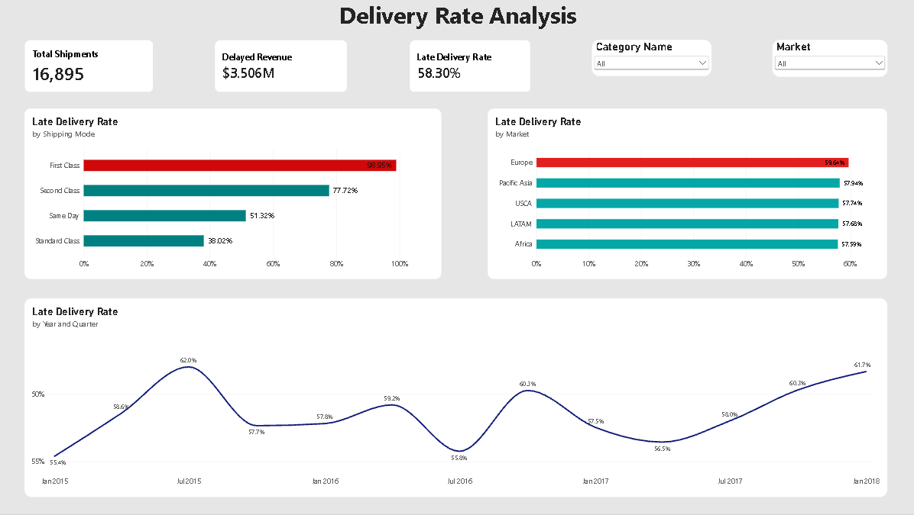

# Supply Chain On-Time Delivery & Revenue Risk Analysis

## Project Overview
An end-to-end operational analytics project analyzing **16,895 global supply chain shipments** to uncover fulfillment bottlenecks, evaluate shipping tier reliability, and quantify revenue exposed to late deliveries.

**Tech Stack:** Python (Pandas), Power BI (DAX, Power Query), Jupyter Notebook

---

## Executive KPIs
* **Total Shipments Analyzed:** 16,895
* **Overall Late Delivery Risk Rate:** 58.30%
* **Total Revenue at Risk (Delayed Orders):** $3.506M

---

## Key Business Insights
1. **Severe SLA Failures in Expedited Shipping:** **First Class** shipments suffered a staggering **98.95% late delivery rate**, followed by **Second Class** at **77.72%** and **Same Day** at **51.32%**. By contrast, **Standard Class** performed best at **38.02%**, indicating that promised delivery windows for expedited tiers are operationally unrealistic.
2. **Widespread Regional Bottlenecks:** Late delivery rates remain consistently elevated across every global market (ranging from **57.59% in Africa** to **59.64% in Europe**), proving that delays are driven by systemic shipping-tier SLA mismatches rather than isolated regional disruptions.
3. **Persistent Multi-Year Delay Trend:** Quarterly tracking from **Q1 2015 through Q1 2018** shows late delivery rates fluctuating between **55.4% and 62.0%**, ending on an upward climb at **61.7%**—signaling an urgent need for intervention.

---

## Actionable Recommendations
* **Recalibrate Expedited SLAs:** Audit warehouse dispatch times and carrier handoffs for First Class and Second Class orders, adjusting customer-facing delivery estimates to reflect realistic transit windows.
* **Prioritize European Fulfillment Lanes:** Focus initial carrier renegotiations and buffer-stock allocation on **Europe (59.64% late rate)** to protect the largest regional share of the **$3.506M** revenue at risk.
* **Standardize Dispatch Workflows:** Replicate the fulfillment buffer logic used in **Standard Class (38.02% late rate)** across higher-priority shipping tiers to stabilize overall on-time performance.

---

## Repository Structure
* `notebooks/supply_chain_eda.ipynb`: Data cleaning, date standardization, feature engineering, and exploratory analysis in Python.
* `dashboard/Supply_Chain_Dashboard.pbix`: Interactive Power BI report featuring custom DAX measures and dynamic Category/Market slicers.
* `dashboard/Supply_Chain.png`: High-resolution preview of the final dashboard.
* `data/cleaned_supply_chain_data.csv`: Dataset documentation and preprocessed data notes.
